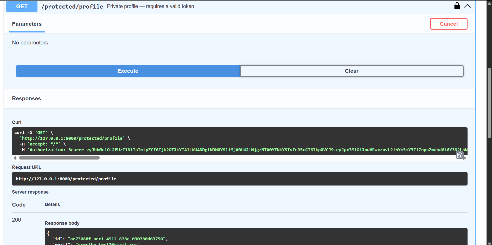
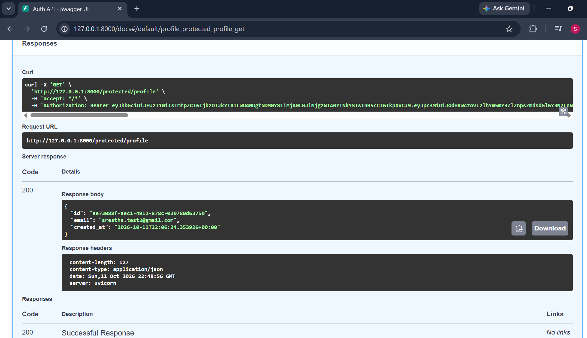

# FastAPI Supabase Auth

A FastAPI service that uses Supabase as its identity provider. Users sign up
and log in through Supabase Auth, receive a JWT access token, and present it
as a Bearer token to reach protected routes. The server never handles
passwords or signs tokens itself — Supabase does that, and the API verifies
every token with Supabase before letting a request through.

## Setup

You need Python 3.10+ and a free Supabase project.

```
git clone https://github.com/sres-092/fastapi-supabase-auth.git
cd fastapi-supabase-auth
python -m venv venv
venv\Scripts\Activate.ps1        # Windows
source venv/bin/activate         # Mac/Linux
pip install -r requirements.txt
```

## Environment variables

Copy `.env.example` to `.env` and fill in your own values from the Supabase
dashboard:

```
SUPABASE_URL=https://your-project-id.supabase.co
SUPABASE_KEY=your_publishable_key
```

- `SUPABASE_URL` — from Data API. Use the base URL, without `/rest/v1/`.
- `SUPABASE_KEY` — the **publishable** key from API Keys. Never use the
  secret key here.

`.env` is git-ignored and never committed.

**One Supabase setting:** under Authentication → Sign In / Providers → Email,
turn off **Confirm email** for local testing. Otherwise signup succeeds but
login fails until the email is confirmed, and the free tier rate-limits
confirmation emails.

## Running it

```
fastapi dev main.py
```

API at http://127.0.0.1:8000, interactive docs at http://127.0.0.1:8000/docs.

## Endpoints

| Method | Path | Auth required | Description |
|--------|------|---------------|-------------|
| POST | /auth/signup | No | Create a new user account |
| POST | /auth/login | No | Log in and receive an access token |
| POST | /auth/logout | Yes | End the current session |
| GET | /public/info | No | Public information |
| GET | /protected/profile | Yes | The logged-in user's id, email and creation date |
| GET | /protected/dashboard | Yes | A second protected route |

## How protection works

Every protected route depends on `get_current_user`, a FastAPI dependency.
It reads the Bearer token through FastAPI's `HTTPBearer` scheme, then asks
Supabase to verify it. If the token is missing, the request gets
`401 Access token required`. If it is forged, tampered with or expired, it
gets `401 Invalid or expired token`. The route itself only runs once the
dependency has returned a verified user.

## Status codes

- `201` — account created
- `200` — successful login or read
- `204` — logged out
- `400` — missing email or password
- `401` — missing, invalid or expired token, or wrong login credentials

## Swagger UI

Click **Authorize**, paste an access token from `/auth/login`, and the
padlocked routes can be tested directly from the browser.

 

